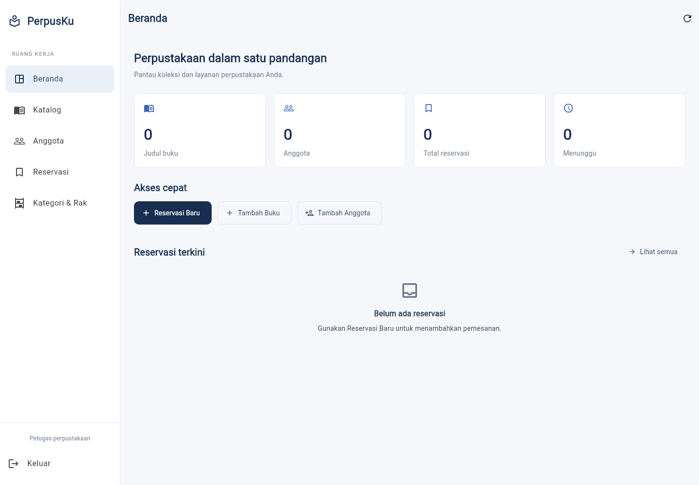

# PerpusKu — Modern Dashboard

Aplikasi manajemen perpustakaan Flutter dengan Supabase dan Provider, dengan UI
responsif untuk desktop, tablet, dan mobile.

## Clone dan jalankan

```bash
git clone https://github.com/gefiranch/perpusku-modern-dashboard.git
cd perpusku-modern-dashboard
flutter pub get
```

Salin `.env.example` menjadi `.env`, lalu isi konfigurasi Supabase proyekmu.
Di Windows, gunakan `copy .env.example .env`. Setelah itu:

```bash
flutter run -d windows
```

Untuk menggabungkan perubahan ke repo kelompok, ikuti
[panduan merge](docs/MERGING.md). Repository ini merupakan fork sehingga riwayat
commit project asal tetap tersambung.

## Hasil redesign

- Beranda dengan ringkasan dari data asli serta reservasi terkini.
- Sidebar desktop, rail tablet, dan menu mobile untuk seluruh modul.
- Katalog, anggota, reservasi, serta kategori/rak dengan tabel dan kartu adaptif.
- Form terstruktur, status, konfirmasi hapus, serta feedback loading/error.
- 145 tes lolos; analisis Flutter bersih pada Flutter 3.47.8 / Dart 3.13.7.



Screenshot memakai data kosong dari repository tes. Integrasi Supabase asli dan
build Windows/Android belum diverifikasi. Siapkan `.env` milik proyek sesuai
panduan di bawah sebelum menjalankan aplikasi.

Lihat [audit desain](docs/REDESIGN_AUDIT.md), [hasil QA](docs/REDESIGN_QA.md),
dan [panduan menjalankan](docs/REDESIGN_HANDOVER.md).

Source awal: https://github.com/REMITMID/projekakhirpamp pada commit
`0e27e1178d5a13b4841a978789cb0801259d4cc8`.

---

## Dokumentasi proyek asal

# 📚 PerpusKu - Sistem Manajemen Perpustakaan Multiplatform

**PerpusKu** adalah aplikasi manajemen perpustakaan berbasis **Flutter Multiplatform** (Android & Windows Desktop) yang terintegrasi dengan **Supabase** sebagai backend (Database & Autentikasi). 

Aplikasi ini menggunakan arsitektur **Clean Architecture** dan state management **Provider**.

---

## 🛠️ 1. Prasyarat & Instalasi Software (Prerequisites)

Sebelum mulai mengerjakan projek ini, pastikan komputer/laptop kamu sudah menginstal perangkat lunak berikut:

1. **Flutter SDK** (Versi 3.x atau terbaru)
   * Pasang Flutter SDK dan pastikan path Flutter sudah terdaftar di Environment Variables.
   * Cek dengan menjalankan perintah: `flutter doctor`
2. **Android Studio / VS Code**
   * Rekomendasi extension VS Code: *Flutter*, *Dart*, dan *GitLens*.
3. **Git**
   * Terinstal di komputer untuk melakukan kolaborasi kode via GitHub.
4. **Android Emulator / Perangkat HP / Windows SDK**
   * Untuk testing aplikasi pada platform Android maupun Windows Desktop.

---

## 🚀 2. Panduan Memulai Pertama Kali (Setup Project)

### Langkah 1: Clone Repository
Buka Terminal/CMD dan jalankan:
```bash
git clone https://github.com/USERNAME/NAMA_REPO.git
cd NAMA_REPO
```

### Langkah 2: Setup File `.env` (PENTING!)
Buat file baru bernama `.env` di **folder utama/root project** (sejajar dengan file `pubspec.yaml`), lalu isi dengan kredensial Supabase berikut:

```env
SUPABASE_URL=https://uduquojfjpnougdovjgf.supabase.co
SUPABASE_ANON_KEY=your-supabase-anon-key-here
```
> **Catatan:** Jangan pernah meng-commit file `.env` asli ke GitHub. File ini sudah aman dimasukkan ke `.gitignore`.

### Langkah 3: Install Dependencies
Jalankan perintah berikut untuk mengunduh semua package Flutter yang dibutuhkan:
```bash
flutter pub get
```

---

## 👥 Pembagian Fitur Utama (Kelompok 2)

| No | Nama Anggota | NIM | Peran / Fitur Utama | Status Operasi Database |
| :-: | :--- | :--- | :--- | :--- |
| 1 | Rafa Maritza Hanasaputri | 245150401111035 | **Fitur 1**: Katalog Buku | Read, Insert, Update, Delete |
| 2 | Ghefira Addien Mifta Mu'afa | 245150400111033 | **Fitur 2**: Manajemen Anggota | Read, Insert, Update, Delete |
| 3 | Jack Sanders Ham | 245150400111011 | **Fitur 3**: Manajemen Reservasi Buku | Read, Insert, Update, Delete |
| 4 | Farah Fadhilah Abhad | 245150400111038 | **Fitur 4**: Kategori & Lokasi Rak | Read, Insert, Update, Delete |

---

## 🏛️ 3. Struktur Folder Project (Clean Architecture)

Semua pengerjaan fitur baru dilakukan di dalam folder `lib/features/`:

```text
lib/
├── core/                     # Modul global (service, constants, theme)
├── features/
│   ├── auth/                 # Fitur Login & Sign Up
│   ├── reservation/          # [Contoh Acuan] Fitur Reservasi Buku (Jack)
│   │   ├── domain/
│   │   │   └── models/       # Model Data (.fromJson & .toJson)
│   │   ├── data/             # Repository koneksi ke Supabase
│   │   └── presentation/
│   │       ├── providers/    # State Management (ChangeNotifier)
│   │       └── pages/        # Tampilan UI (List, Detail, Form Input)
│   ├── catalog/              # ⬅️ (Fitur Rafa: Katalog Buku)
│   ├── member/               # ⬅️ (Fitur Ghefira: Manajemen Anggota)
│   └── category_rack/        # ⬅️ (Fitur Farah: Kategori & Lokasi Rak)
└── main.dart                 # Inisialisasi Supabase & MultiProvider
```

---

## 💡 4. Panduan Langkah Kerja Menambahkan Fitur Baru

Untuk setiap anggota yang akan membuat fiturnya, ikuti 4 langkah standar ini:

### Step 1: Buat Tabel di Supabase
Buka **Dashboard Supabase** $\rightarrow$ **SQL Editor**, buat tabel dan aktifkan **Row Level Security (RLS)**:

```sql
-- Contoh membuat tabel
create table public.nama_tabel_kamu (
  id uuid default gen_random_uuid() primary key,
  nama_kolom_1 text not null,
  nama_kolom_2 text not null,
  created_at timestamp with time zone default timezone('utc'::text, now()) not null
);

-- WAJIB: Aktifkan RLS dan Policy agar Flutter bisa CRUD
alter table public.nama_tabel_kamu enable row level security;

create policy "Enable all access for all users" 
on public.nama_tabel_kamu for all 
using (true) with check (true);
```

### Step 2: Buat Model Data & Repository
Buat file `Model` dan `Repository` untuk mengelola query Supabase (`select`, `insert`, `update`, `delete`).

```dart
// Contoh query repository Supabase:
await Supabase.instance.client.from('nama_tabel').select();
await Supabase.instance.client.from('nama_tabel').insert(data.toJson());
await Supabase.instance.client.from('nama_tabel').update(data.toJson()).eq('id', id);
await Supabase.instance.client.from('nama_tabel').delete().eq('id', id);
```

### Step 3: Buat Provider (State Management)
Buat kelas `ChangeNotifier` untuk menangani perubahan state data pada UI.

### Step 4: Daftarkan Provider di `main.dart`
Buka file `lib/main.dart` dan tambahkan Provider kamu di bagian `MultiProvider`:

```dart
MultiProvider(
  providers: [
    ChangeNotifierProvider(create: (_) => AuthProvider()),
    ChangeNotifierProvider(create: (_) => ReservationProvider()),
    ChangeNotifierProvider(create: (_) => FiturKamuProvider()), // ⬅️ Tambahkan di sini
  ],
  child: const MyApp(),
)
```

---

## 📱 5. Cara Menjalankan Aplikasi (Multiplatform)

### Running di Android:
```bash
flutter run -d android
```

### Running di Windows Desktop:
```bash
flutter config --enable-windows-desktop
flutter run -d windows
```

---

## 🌿 6. Aturan Git Workflow (Sangat Penting!)

Agar kode antar anggota tidak saling menimpa (*conflict*), selalu ikuti alur berikut:

1. **Sebelum mulai ngoding**, selalu ambil update kode terbaru:
   ```bash
   git pull origin main
   ```
2. Setelah selesai menambah / mengubah kode, lakukan commit:
   ```bash
   git add .
   git commit -m "feat(nama-fitur): menambahkan halaman form input"
   ```
3. Push kode kamu ke GitHub:
   ```bash
   git push origin main
   ```